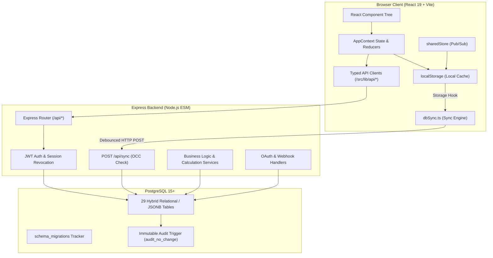

# AgencyOS

<div align="center">


[](https://nodejs.org/)
[](https://react.dev/)
[](https://www.typescriptlang.org/)
[](https://vitejs.dev/)
[](https://tailwindcss.com/)
[](https://www.postgresql.org/)
[](#-license)

**An integrated enterprise operating system and ERP platform tailor-made for creative, marketing, digital media, and advertising agencies.**

[Features](#-core-features) • [Tech Stack](#-tech-stack) • [Quick Start](#-quick-start) • [Architecture](#-architecture-overview) • [Database & Migrations](#-database--migrations) • [Scripts](#-scripts-reference) • [Documentation](#-documentation)

</div>

---

## 📖 Overview

**AgencyOS** consolidates agency workflows into a single unified workspace. By eliminating disjointed spreadsheets, standalone HR tools, and separate CRM systems, AgencyOS provides complete visibility across the agency lifecycle: from lead qualification and client agreements to task dispatch, field force GPS tracking, automated payroll calculations, and GST-compliant invoicing.

Built with an **offline-first, client-synchronized** foundation, the web application delivers instant sub-millisecond local UI interactions backed by debounced background PostgreSQL synchronization and optimistic concurrency control (OCC).

---

## 🚀 Core Features

### 👥 Human Resources & Payroll
- **Staff Directory**: Complete employee profiles, organizational hierarchy, department mapping, and designation levels.
- **Attendance & Regularization**: Daily check-in/out logging, missed punch regularization requests, and team lead approval workflows.
- **Leave Management**: Entitlement tracking, accrual ledgers, and multi-tier leave approval routing.
- **Expense Claims & Reimbursements**: Receipt uploads, expense categorization, and one-click reimbursement approvals.
- **Statutory Payroll Engine**: Automatic monthly salary computation factoring in working days, deductions, Provident Fund (PF), Employee State Insurance (ESI), and Tax Deducted at Source (TDS).

### 💼 Client Relationship Management (CRM)
- **Lead Pipeline**: Kanban and list views for tracking prospect stages, estimated deal values, and source channels.
- **Client Accounts & Contracts**: Master client records, retainers, and Service Level Agreements (SLAs).
- **Quotation Generator**: Custom line-item proposals with client discounts, taxes, and instant PDF/print export.
- **One-Click Lead Conversion**: Automatically convert qualified leads into clients with scaffolded project shells.

### 📋 Projects & Task Orchestration
- **Task Dispatch**: Assign tasks to team members with due dates, priority ratings, and milestone tags.
- **Activity Feed**: Real-time team activity logs, daily standup notes, and project deliverables tracking.
- **Role-Filtered Views**: Team leads and department heads monitor their direct reports while staff see personal queues.

### 💰 Billing, Expenses & Finance
- **GST-Compliant Invoicing**: Professional invoice generation with customizable line items, tax rates, and due dates.
- **Payment Settlements**: Record full and partial customer payments against invoices with balance reconciliations.
- **Expense Tracking**: Categorized operating expenses linked to employees and projects.
- **Real-Time Financial Analytics**: Interactive dashboards for revenue metrics, receivables, and operational burn rate.

### 📍 Field Force & GPS Tracking
- **Geolocation Check-In**: Field sales and client representatives register GPS-tagged check-ins with latitude/longitude coordinates.
- **Visit Verification**: Track client site meetings, record visit notes, and capture checkout verification signatures.

### 🔐 Security, RBAC & Compliance
- **Role-Based Access Control (RBAC)**: Comprehensive permission matrix (`super_admin`, `admin`, `manager`, `hr`, `finance`, `sales_manager`, `team_leader`, `staff`, `auditor`) with row-level ownership enforcement.
- **Session Management**: Active JWT session tracking with remote individual or global session termination.
- **Tamper-Proof Audit Trail**: Immutable append-only audit logging triggered directly at the PostgreSQL database level (`audit_no_change`).
- **Encrypted Integrations**: AES-encrypted storage of third-party OAuth access and refresh tokens.

### ⚡ Offline-First Synchronization & Concurrency
- **Instant Responsiveness**: UI reads and writes to local memory backed by `localStorage`.
- **Debounced DB Sync**: Background mutations batch-sync to PostgreSQL via `POST /api/sync`.
- **Optimistic Concurrency Control (OCC)**: Built-in `version` increments detect and prevent concurrent write conflicts.

### 🔗 Integrations & Webhooks
- **Google Calendar**: Bi-directional OAuth 2.0 synchronization for tasks, milestones, and client meetings.
- **Inbound Webhooks**: Secure HMAC-SHA256 verified webhooks (e.g., WhatsApp business messaging notifications).

---

## 🛠 Tech Stack

| Layer | Technologies |
| :--- | :--- |
| **Frontend** | React 19, TypeScript, Vite 8, Tailwind CSS v4, Lucide Icons |
| **Backend** | Node.js (ESM), Express 4.21, `pg` (PostgreSQL client pool) |
| **Database** | PostgreSQL 15+ (Hosted on Supabase or self-hosted PostgreSQL) |
| **Security & Auth** | JSON Web Tokens (JWT), `bcryptjs`, Node.js `crypto` |
| **Architecture** | Hybrid Relational / JSONB document storage with versioned migrations |
| **Deployment** | Vercel Serverless Ready (`vercel.json`, `api/`), Node.js standalone |
| **CI / CD** | GitHub Actions (`.github/workflows/ci.yml`) |

---

## 🏗 Architecture Overview



---

## ⚡ Quick Start

### 1. Prerequisites
- **Node.js**: `v20.0.0` or higher ([Download Node.js](https://nodejs.org/))
- **PostgreSQL**: PostgreSQL 15+ (Local or cloud database such as [Supabase](https://supabase.com))

### 2. Clone and Install
```bash
git clone <YOUR_REPOSITORY_URL>
cd agencyos
npm install
```

### 3. Configure Environment Variables
Copy `.env.example` to `.env`:
```bash
cp .env.example .env
```

Configure your parameters in `.env`:
```ini
# Database (PostgreSQL / Supabase)
DATABASE_URL=postgresql://postgres:<PASSWORD>@<HOST>:5432/postgres
DB_SSL=true

# Security
JWT_SECRET=your_super_secret_jwt_key_at_least_16_chars
TOKEN_ENCRYPTION_KEY=your_32_byte_token_encryption_key_for_integrations

# Optional Initial Super Admin Credentials (used during db:seed)
INITIAL_ADMIN_EMAIL=rajesh.sharma@priorityadsagency.com
INITIAL_ADMIN_PASSWORD=YourStrongInitialAdminPassword123!

# Server Port
PORT=4000
```

### 4. Initialize Database & Seed Master Data
Run the migrations and authoritative seeder:
```bash
npm run db:setup
```
This executes:
1. `npm run db:migrate`: Creates relational tables, indexes, and applies all SQL migrations.
2. `npm run db:seed`: Seeds default company profile, departments, designations, compliance rules, and initial Super Admin user.

### 5. Launch Development Server
```bash
npm run dev
```

The application will be live at:
- **Web Frontend**: [http://localhost:3000](http://localhost:3000)
- **Backend API**: [http://localhost:4000](http://localhost:4000)
- **Server Health / Diagnostics**: [http://localhost:4000/api/server](http://localhost:4000/api/server)

---

## 📂 Project Structure

```text
agencyos/
├── .github/
│   └── workflows/
│       └── ci.yml               # GitHub Actions CI workflow
├── api/                         # Vercel serverless functions
├── docs/                        # Detailed architectural specifications
│   ├── API.md                   # Complete REST endpoint catalog
│   ├── ARCHITECTURE.md          # System architecture & data flow
│   ├── DATABASE.md              # Database schema & migrations spec
│   └── DEPLOYMENT.md            # Cloud deployment & environment guide
├── public/                      # Static assets, branding, and letterheads
├── scripts/
│   └── test-runner.mjs          # Sanity & runtime test suite
├── server/                      # Express ESM backend service
│   ├── migrations/              # Versioned SQL migrations (001, 002)
│   ├── services/                # Backend business services
│   ├── utils/                   # Server utility functions
│   ├── defaults.json            # Master system configurations & roles
│   ├── index.mjs                # Main Express server entry point
│   ├── migrate.mjs              # Standalone migration runner
│   └── seed.mjs                 # Authoritative database seeder
├── src/                         # React 19 frontend application
│   ├── components/              # Modular UI components & domain views
│   ├── context/                 # Central application state (AppContext)
│   ├── data/                    # Fallback initial data sets
│   ├── lib/                     # Client libraries (auth, api, rbac, sync)
│   │   ├── api/                 # Typed API abstraction services
│   │   └── auth/                # JWT session management & token storage
│   ├── os/                      # AgencyOS shell, routing, and navigation
│   ├── App.tsx                  # Root application component
│   └── main.tsx                 # Client entry point
├── package.json                 # Project configuration & npm scripts
├── tsconfig.json                # TypeScript compiler configuration
├── vercel.json                  # Vercel production hosting configuration
└── vite.config.ts               # Vite build configuration & API proxy
```

---

## 📜 Scripts Reference

| Command | Action |
| :--- | :--- |
| `npm run dev` | Concurrently launches backend server (`:4000`) and Vite frontend (`:3000`) |
| `npm run dev:web` | Starts only the Vite frontend dev server on port 3000 |
| `npm run server` | Starts only the Express backend server on port 4000 |
| `npm run build` | Compiles the production React/TypeScript bundle to `dist/` |
| `npm run preview` | Locally serves and previews the production build |
| `npm run lint` | Runs TypeScript static type checking without emitting files (`tsc --noEmit`) |
| `npm test` | Runs the test runner (`scripts/test-runner.mjs`) |
| `npm run db:migrate` | Runs all pending versioned migrations in `server/migrations/` |
| `npm run db:seed` | Populates database with company profile, org hierarchy, and admin account |
| `npm run db:setup` | Runs migration followed by seeding (`db:migrate && db:seed`) |
| `npm run clean` | Deletes build artifacts and temporary distribution files |

---

## 🧪 Testing & Continuous Integration

AgencyOS includes automated checks integrated into GitHub Actions (`.github/workflows/ci.yml`):

- **Type Safety**: Enforced via TypeScript (`npm run lint`).
- **Runtime Integrity**: Verified via `npm test` (`scripts/test-runner.mjs`), validating Node.js engine compatibility (>=20) and environment sanity.
- **Production Build**: Verified via Vite (`npm run build`).

Run all verification checks locally:
```bash
npm test; npm run lint; npm run build
```

---

## 📚 Documentation

For in-depth guides and technical specifications, explore the [`docs/`](docs/) directory:

- 🏗 **[Architecture Overview](docs/ARCHITECTURE.md)**: Deep dive into offline-first sync lifecycle, API client design, OCC conflict detection, and RBAC matrix.
- 🗄 **[Database Specification](docs/DATABASE.md)**: Entity-relationship diagram, hybrid relational/JSONB table schemas, and versioned migration guide.
- 🔌 **[API Reference](docs/API.md)**: Complete endpoint catalog covering authentication, synchronization, workflows, and integrations.
- 🚢 **[Deployment Guide](docs/DEPLOYMENT.md)**: Production deployment instructions for Supabase, Vercel, and environment variables guide.

---

## 📄 License

Internal Agency Platform — Proprietary. All rights reserved.
