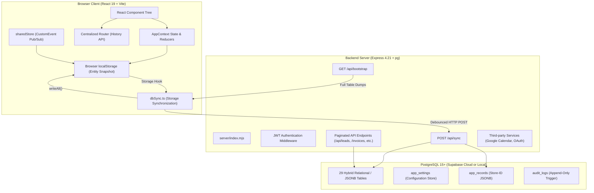

# AgencyOS Architecture

AgencyOS is an integrated enterprise ERP and management operating system built for advertising and creative agencies. It combines human resources, client relationship management, task orchestration, financial billing, and audit reporting into an offline-first, client-synchronized web platform.

---

## 1. High-Level System Architecture

---

## 2. Core Architectural Pillars

### 2.1 Hybrid Offline-First / Client Synchronization
- **Client Store**: Frontend state is loaded into memory and backed by `localStorage` for responsive UI rendering and offline tolerance.
- **Sync Engine (`src/os/dbSync.ts`)**: Changes trigger debounced synchronization requests (`POST /api/sync`) to persist modifications into PostgreSQL.
- **Bootstrap (`GET /api/bootstrap`)**: On session initialization, the client syncs table snapshots from the backend to ensure consistency across devices and users.

### 2.2 Hybrid PostgreSQL Model
- **Structured Columns**: High-frequency query columns (e.g., `employee_code`, `status`, `date`, `client_id`, `total`) are extracted as native columns with relational indexes and foreign keys.
- **Full Entity JSONB (`data jsonb`)**: Retains complete record documents with flexible schema attributes and version tracking.
- **Optimistic Concurrency**: Records increment `version` counter upon mutations to detect conflicts.

### 2.3 Role-Based Access Control (RBAC)
- **Role Hierarchy**: Roles include `super_admin`, `admin`, `manager`, `hr`, `finance`, `sales_manager`, `team_leader`, `staff`, `auditor`, and more.
- **Permission Matrix**: Module-level view permissions (`V`) and CRUD actions:
  - `C`: Create
  - `E`: Edit
  - `D`: Delete
  - `A`: Approve (leave, attendance, reimbursements)
  - `X`: Export
- **Row-Level Ownership**: Staff users are constrained to records assigned to their own `employee_id`.

### 2.4 Immutable Audit Logging
- **Append-Only Integrity**: The `audit_logs` table has a database-level trigger (`audit_no_change()`) blocking `UPDATE` and `DELETE` queries, ensuring tamper-proof audit trails for compliance.
