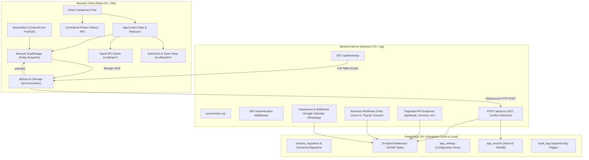

# AgencyOS Architecture

AgencyOS is an integrated enterprise ERP and management operating system built for advertising and creative agencies. It combines human resources, client relationship management, task orchestration, financial billing, GPS field visit tracking, third-party integrations, and audit reporting into an offline-first, client-synchronized web platform.

---

## 1. High-Level System Architecture

---

## 2. Core Architectural Pillars

### 2.1 Hybrid Offline-First / Client Synchronization
- **Client Store**: Frontend state is loaded into memory and backed by `localStorage` for responsive UI rendering and offline tolerance.
- **Sync Engine (`src/lib/dbSync.ts`)**: State mutations trigger debounced background synchronization requests (`POST /api/sync`) to persist modifications into PostgreSQL.
- **Optimistic Concurrency Control (OCC)**: Each entity maintains a numeric `version` counter. When updates are submitted via `POST /api/sync`, the backend checks the version to detect concurrent modifications and prevent accidental overwrite of newer data.
- **Bootstrap (`GET /api/bootstrap`)**: On session initialization, the client fetches table snapshots from the backend to ensure consistency across devices and users.
- **Delta Feed (`GET /api/changes`)**: Periodically queries changes since the last sync timestamp to fetch updates made by other users.

### 2.2 Hybrid PostgreSQL Model
- **Structured Columns**: High-frequency query columns (e.g., `employee_code`, `status`, `date`, `client_id`, `total`, `assigned_employee_id`) are extracted as native columns with relational indexes and foreign keys.
- **Full Entity JSONB (`data jsonb`)**: Retains complete record documents with flexible schema attributes and version tracking.
- **Relational Integrity & Migrations**: Managed via `server/migrate.mjs` and versioned migration files in `server/migrations/` (such as `001_relational_constraints.sql` and `002_extended_relational_integrity.sql`).

### 2.3 Modular API & Authentication Abstraction
- **API Clients (`src/lib/api/`)**: Domain-specific typed API services (`leadsApi.ts`, `invoicesApi.ts`, `payrollApi.ts`, `tasksApi.ts`, `clientsApi.ts`) encapsulate HTTP interactions with `apiClient.ts`.
- **Authentication Service (`src/lib/auth/`)**: Handles JWT storage in secure local storage, bearer token attachment, token renewal, and profile state.

### 2.4 Role-Based Access Control (RBAC)
- **Role Hierarchy**: Roles include `super_admin`, `admin`, `manager`, `hr`, `finance`, `sales_manager`, `team_leader`, `staff`, `auditor`, and more.
- **Permission Matrix**: Module-level view permissions (`V`) and CRUD actions:
  - `C`: Create
  - `E`: Edit
  - `D`: Delete
  - `A`: Approve (leave, attendance, reimbursements)
  - `X`: Export
- **Row-Level Ownership**: Staff users are constrained to records assigned to their own `employee_id`.

### 2.5 Immutable Audit Logging
- **Append-Only Integrity**: The `audit_logs` table has a database-level trigger (`audit_no_change()`) blocking `UPDATE` and `DELETE` queries, ensuring tamper-proof audit trails for compliance.

### 2.6 Third-Party Integrations & Workflows
- **Google Calendar Synchronization**: OAuth 2.0 flow with encrypted token persistence (`TOKEN_ENCRYPTION_KEY`) for synchronizing tasks and schedules.
- **Webhook Gateway**: HMAC-SHA256 signature verification for external webhooks (e.g. WhatsApp messaging).
- **Field Force & GPS Module**: Location capture and checkout recording for field sales and customer support representatives.
