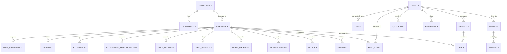

# AgencyOS Database Specification

AgencyOS uses PostgreSQL (hosted on Supabase or running locally) with a hybrid relational + JSONB document model. Structured columns are extracted for indexing, relational integrity, and foreign keys, while the complete entity state is stored in `data jsonb`.

---

## 1. Entity Relationship Overview



---

## 2. Core Tables Reference

| Table Name | Description | Key Extracted Columns | Relational References |
| :--- | :--- | :--- | :--- |
| `departments` | Organizational departments | `name` (Unique) | - |
| `designations` | Job roles / titles | `title`, `department_id` | `department_id` -> `departments(id)` |
| `employees` | Staff & user directory | `employee_code`, `name`, `email`, `role`, `status` | `email`, `employee_code` are Unique |
| `user_credentials` | Auth password hashes & flags | `employee_id`, `password_hash`, `must_change` | `employee_id` -> `employees(id)` |
| `sessions` | Active JWT user sessions | `employee_id`, `ip`, `user_agent`, `last_seen` | `employee_id` -> `employees(id)` |
| `clients` | Agency client accounts | `client_code`, `company_name`, `phone`, `email` | - |
| `leads` | Inbound & prospect leads | `lead_code`, `company`, `estimated_value`, `status` | `assigned_employee_id` -> `employees(id)` |
| `quotations` | Client price proposals | `number`, `client_id`, `total`, `discount` | `client_id` -> `clients(id)` |
| `agreements` | Retainer & service contracts | `number`, `client_id`, `end_date`, `status` | `client_id` -> `clients(id)` |
| `projects` | Client delivery projects | `project_code`, `name`, `client_id`, `project_manager_id` | `client_id` -> `clients(id)` |
| `tasks` | Project work items | `task_code`, `title`, `project_id`, `assigned_employee_id`, `due_date` | `project_id`, `assigned_employee_id` |
| `invoices` | Billing invoices | `number`, `client_id`, `issue_date`, `due_date`, `total`, `balance` | `client_id` -> `clients(id)` |
| `payments` | Customer payment receipts | `code`, `invoice_id`, `date`, `amount` | `invoice_id` -> `invoices(id)` |
| `expenses` | Agency operating expenses | `code`, `category`, `amount`, `date`, `employee_id` | `employee_id` -> `employees(id)` |
| `attendance` | Daily employee attendance | `employee_id`, `date`, `status` | `employee_id` -> `employees(id)` |
| `leave_requests` | Leave applications | `code`, `employee_id`, `leave_type`, `start_date`, `status` | `employee_id` -> `employees(id)` |
| `payslips` | Monthly generated payslips | `number`, `employee_id`, `pay_period` | `employee_id` -> `employees(id)` |
| `audit_logs` | Immutable audit trail | `user_id`, `user_name`, `action`, `related_record`, `date`, `time` | Append-only database trigger |
| `app_records` | Generic store records | `store`, `id`, `data`, `version` | Composite PK `(store, id)` |
| `app_settings` | Global app configuration | `key`, `value`, `version` | PK `key` |

---

## 3. Schema Migrations

Database tables and indexes are initialized automatically on backend startup via `migrate()` in `server/index.mjs` and relational constraints in `server/migrations/001_relational_constraints.sql`.

### Manual Schema Migration / Inspection
You can also run or import the schema using `agencyos.sql`:
```bash
psql -h <DB_HOST> -U <DB_USER> -d <DB_NAME> -f agencyos.sql
```
