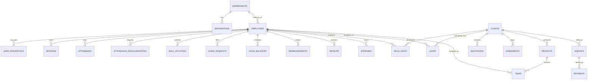

# AgencyOS Database Specification

AgencyOS uses PostgreSQL (hosted on Supabase or running locally) with a hybrid relational + JSONB document model. Structured columns are extracted for indexing, relational integrity, and foreign keys, while the complete entity state is stored in `data jsonb`.

---

## 1. Entity Relationship Overview



---

## 2. Core Tables Reference

| Table Name | Description | Key Extracted Columns | Relational References |
| :--- | :--- | :--- | :--- |
| `departments` | Organizational departments | `name` (Unique) | - |
| `designations` | Job roles / titles | `title`, `department_id` | `department_id` -> `departments(id)` |
| `employees` | Staff & user directory | `employee_code`, `name`, `email`, `role`, `status` | `lower(email)` unique index, `employee_code` Unique |
| `user_credentials` | Auth password hashes & flags | `employee_id`, `password_hash`, `must_change` | `employee_id` -> `employees(id)` |
| `sessions` | Active JWT user sessions | `employee_id`, `ip`, `user_agent`, `last_seen`, `revoked_at` | `employee_id` -> `employees(id)` |
| `clients` | Agency client accounts | `client_code`, `company_name`, `phone`, `email` | - |
| `leads` | Inbound & prospect leads | `lead_code`, `company`, `estimated_value`, `status`, `assigned_employee_id` | `assigned_employee_id` -> `employees(id)` |
| `quotations` | Client price proposals | `number`, `client_id`, `total`, `discount` | `client_id` -> `clients(id)` |
| `agreements` | Retainer & service contracts | `number`, `client_id`, `end_date`, `status` | `client_id` -> `clients(id)` |
| `projects` | Client delivery projects | `project_code`, `name`, `client_id`, `project_manager_id` | `client_id` -> `clients(id)` |
| `tasks` | Project work items | `task_code`, `title`, `project_id`, `assigned_employee_id`, `due_date` | `project_id` -> `projects(id)`, `assigned_employee_id` -> `employees(id)` |
| `field_visits` | GPS-tracked field visits | `employee_id`, `client_id`, `status` | `employee_id` -> `employees(id)`, `client_id` -> `clients(id)` |
| `invoices` | Billing invoices | `number`, `client_id`, `issue_date`, `due_date`, `total`, `balance` | `client_id` -> `clients(id)` |
| `payments` | Customer payment receipts | `code`, `invoice_id`, `date`, `amount` | `invoice_id` -> `invoices(id)` |
| `expenses` | Agency operating expenses | `code`, `category`, `amount`, `date`, `employee_id` | `employee_id` -> `employees(id)` |
| `attendance` | Daily employee attendance | `employee_id`, `date`, `status` | `employee_id` -> `employees(id)` |
| `attendance_regularizations`| Attendance dispute logs | `employee_id`, `date`, `status` | `employee_id` -> `employees(id)` |
| `daily_activities` | Work logging / standups | `employee_id`, `date` | `employee_id` -> `employees(id)` |
| `leave_requests` | Leave applications | `code`, `employee_id`, `leave_type`, `start_date`, `status` | `employee_id` -> `employees(id)` |
| `leave_balances` | Entitlement & accrued leave | `employee_id`, `leave_type`, `balance` | `employee_id` -> `employees(id)` |
| `reimbursements` | Expense claims | `code`, `employee_id`, `date`, `amount`, `status` | `employee_id` -> `employees(id)` |
| `payslips` | Monthly generated payslips | `number`, `employee_id`, `pay_period` | `employee_id` -> `employees(id)` |
| `audit_logs` | Immutable audit trail | `user_id`, `user_name`, `action`, `related_record`, `date`, `time` | Append-only database trigger (`audit_no_change`) |
| `app_records` | Generic store records | `store`, `id`, `data`, `version` | Composite PK `(store, id)` |
| `app_settings` | Global app configuration | `key`, `value`, `version` | PK `key` |
| `schema_migrations` | Migration history log | `version`, `applied_at` | PK `version` |

---

## 3. Schema Migrations Architecture

AgencyOS features a dedicated migration runner (`server/migrate.mjs`) that tracks execution status inside the `schema_migrations` table.

### Automated Execution
Running the setup or migration scripts applies all pending migrations in sequential order:
```bash
npm run db:migrate
```

### Versioned Migration Files (`server/migrations/`)
1. **`001_relational_constraints.sql`**:
   - Creates foreign key constraints across departments, designations, tasks, projects, invoices, payments, and employee records.
   - Sets up cascading rules (`ON DELETE CASCADE` or `ON DELETE SET NULL`) to protect referential integrity while retaining audit data.
2. **`002_extended_relational_integrity.sql`**:
   - Enforces unique email constraint case-insensitively via `CREATE UNIQUE INDEX idx_employees_email_lower_unique ON employees (lower(email))`.
   - Links `expenses.employee_id` -> `employees(id)`.
   - Links `field_visits.employee_id` -> `employees(id)` and `field_visits.client_id` -> `clients(id)`.
   - Links `leads.assigned_employee_id` -> `employees(id)`.

---

## 4. Master Data Seeding

The authoritative seeder (`server/seed.mjs`) populates initial master data idempotently:
```bash
npm run db:seed
```

This bootstraps:
- **Company Profile**: Name, address, GSTIN, PAN, and contact information.
- **Departments & Designations**: Standard organizational structure (Executive, HR, Engineering, Sales, Finance, Media).
- **Statutory Rules**: PF, ESI, professional tax, and standard deduction slabs.
- **Super Administrator Account**: Created from `INITIAL_ADMIN_EMAIL` and `INITIAL_ADMIN_PASSWORD` (or securely generated random password).
- **RBAC Matrix**: Module permissions and access scopes.

To run migrations and seeding together:
```bash
npm run db:setup
```
